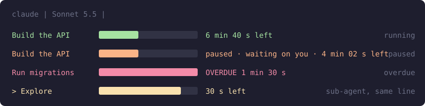

# Clock Bar

Oven-timer bars for Claude Code, in the status line. Extends the `/clock` skill. Built on [eta-bar](https://github.com/DrEvil-TitaniumHelix/eta-bar) by DrEvil (MIT).

- **One bar per task, one per sub-agent**, all on the same status line.
- **Paused = the clock stops.** Claude pauses when it waits on something (`pause "why"`), a more urgent task takes over (`push`), or a permission prompt / question is open (automatic, "waiting on you"). Waiting never counts as overdue.
- **Overdue check-ins** at the deadline, +30 s, +1 min, +2 min, +4 min, then every 8 min: a Windows notification (detached watcher, works during a long tool call) and an `OVERDUE` note in Claude's context from the next hook.
- Forgot to post an ETA? After 30 s of work a hook reminds Claude, then every 2 min.
- A turn ending does not wipe the bars while a background job or a sub-agent is still running.

## Commands (Claude runs these)
`set "note" 8 [--id ID]` · `push "note" 8` · `done [--id ID]` · `pause "why" [--id ID]` · `resume [--id ID]`
Time accepts `8` (minutes), `90s`, `2h` or `07:48`.

## Install
1. Copy this folder anywhere, e.g. `~/.claude/clock-bar/`.
2. Add the hooks from `hooks/hooks.json` to `~/.claude/settings.json`, replacing `${CLAUDE_PLUGIN_ROOT}` with the real path.
3. Add the status line: `"statusLine": {"type": "command", "command": "python <path>/statusline.py", "refreshInterval": 5}`. Already have one? Append the output of `python clockbar.py line <session_id>`.
4. Use the updated `clock/SKILL.md` so Claude knows the commands.

Check: `python clockbar.py selftest`. State lives in `~/.claude/clockbar/<session_id>.json`. Python 3, stdlib only. Notifications are Windows only; the bars work anywhere.
